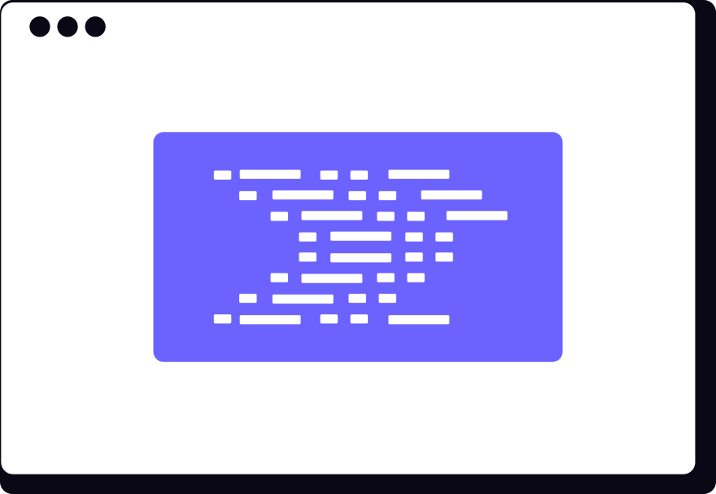
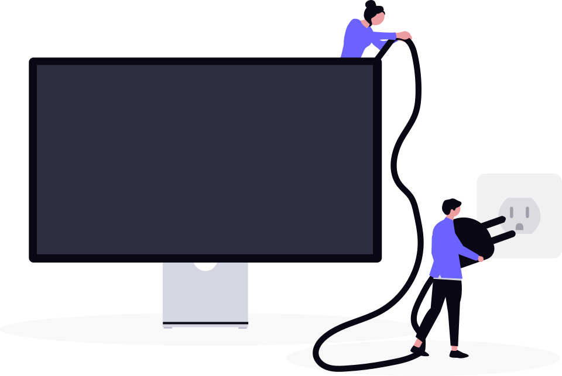
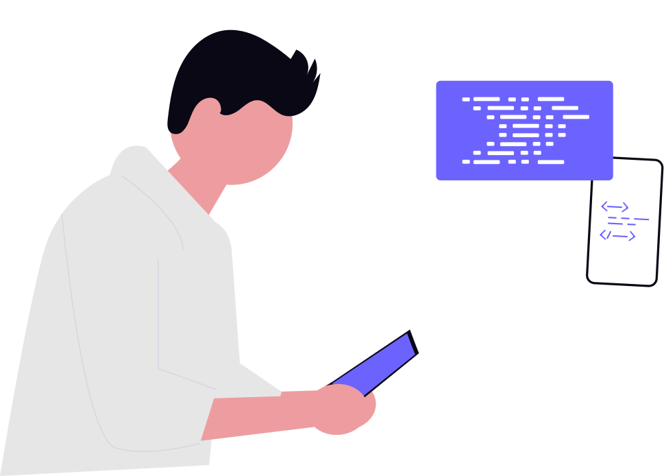

 

# Hazem

### Full-Stack Developer · Programmer · Tech Creator

Building useful digital experiences through code.

---

## About Me

I'm a developer interested in building websites, applications, and tools that solve real problems.

I enjoy exploring new technologies, experimenting with ideas, and turning concepts into working projects.

- Currently developing my programming skills.
- Interested in full-stack web development.
- Enjoy building practical projects and experimenting with technology.
- Always learning and improving.

 

## Tech Stack

### Languages & Frameworks

### Tools & Platforms

### Other Platforms

---

## Featured Projects

### 01 — Yawmi

An Arabic student-focused productivity web app designed to help organize everyday activities.

**Focus:** Productivity · Scheduling · Student tools

 

### 02 — MiniTerm

A programming project exploring terminal-style interfaces and Python development.

**Focus:** Python · Programming

 

### 03 — Emaar Gulf

A software project focused on building useful digital tools and workflows.

**Focus:** Software Development

 

### 04 — Side Quest Arabi

An Arabic content creation project involving scripting, editing, and video production.

**Focus:** Content Creation · Video Production

 

### 05 — Lazem Toolkit Backend

A backend project connected to the Lazem Toolkit ecosystem.

**Focus:** Backend Development

 

---

## Currently Learning

My learning direction is **Full-Stack Development**.

| Technology | Status |
|---|---|
| Python | Learning & building |
| HTML | Learning & building |
| CSS | Learning & building |
| JavaScript | Next focus |
| React | Future focus |
| Backend development | Future focus |
| Databases & APIs | Future focus |

 

---

## GitHub Statistics

---

## Content & Creativity

Outside programming, I also enjoy creating technology tutorials, experimenting with ideas, and sharing what I learn.

My content focuses on programming, websites, applications, and technology.

 

---

## Let's Connect

**Thanks for visiting my profile!**

*Learn. Build. Improve. Repeat.*

